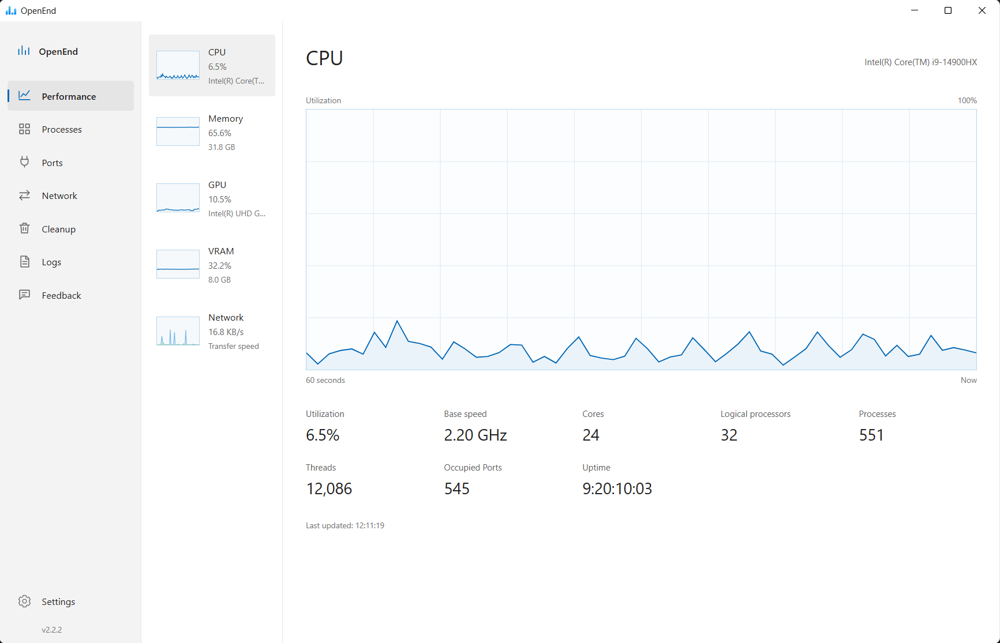
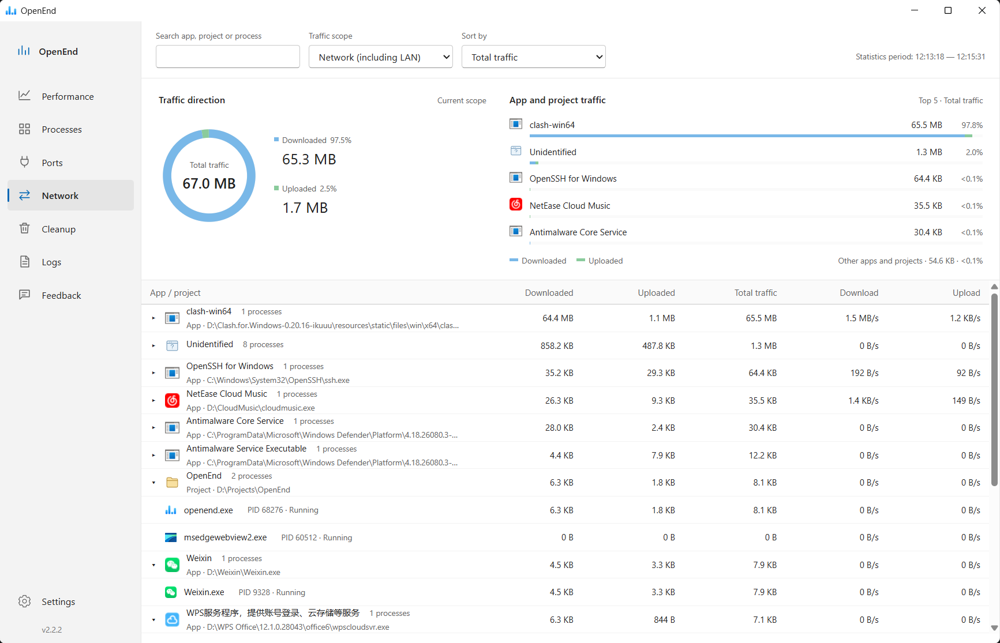
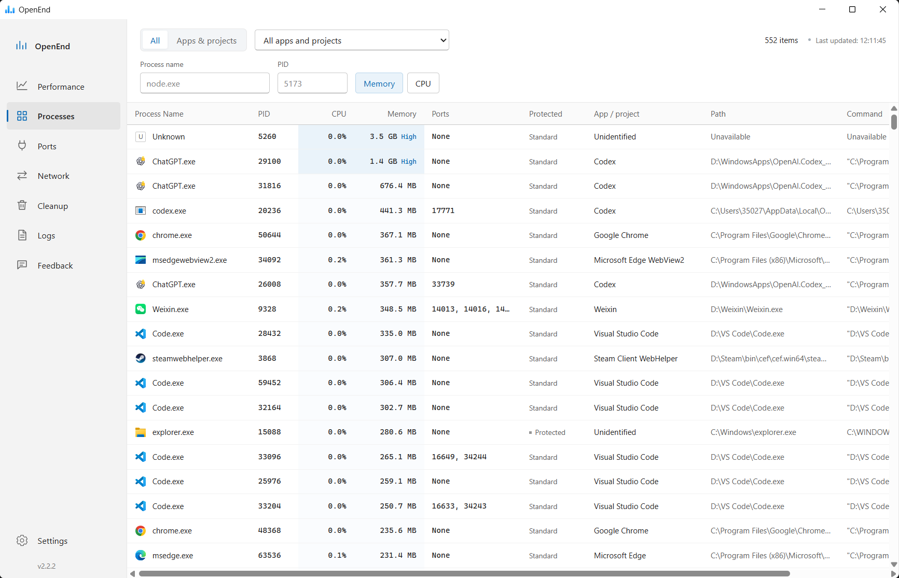
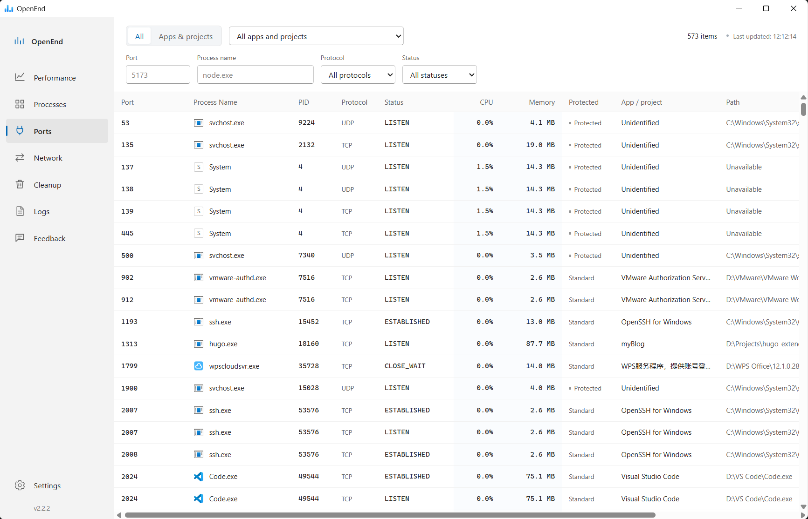
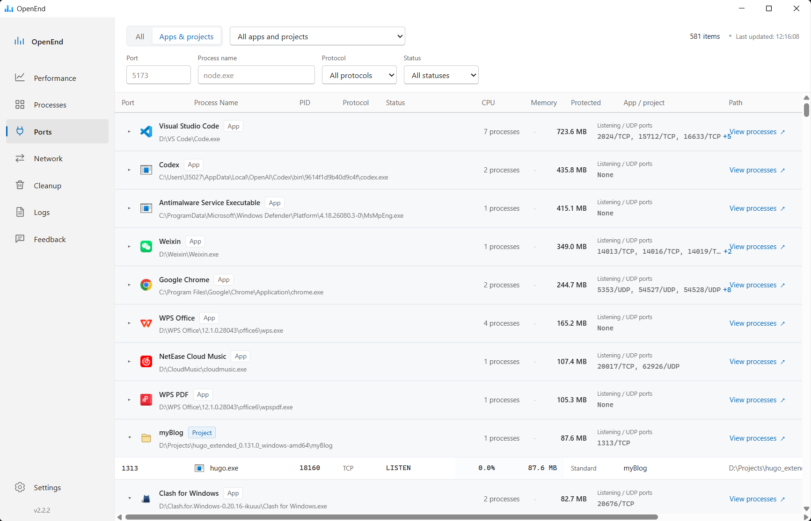
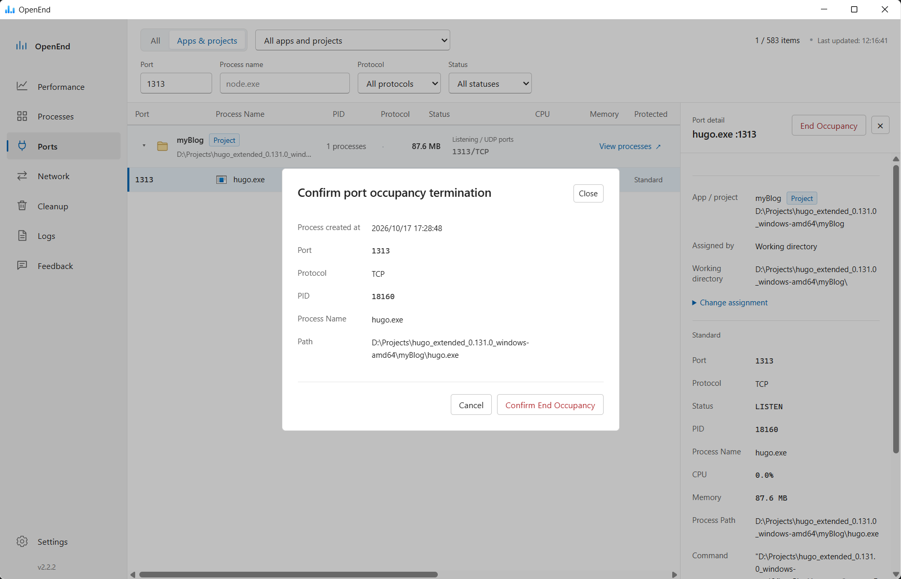

<p align="center">
  
</p>

<p align="center">
  <a href="https://github.com/SymphonyW/OpenEnd/releases"></a>
  
  
  
  
  
  
</p>

<p align="center">
  English | <a href="README.zh-CN.md">简体中文</a>
</p>

# OpenEnd

[Download Windows installer](https://github.com/SymphonyW/OpenEnd/releases/download/v2.2.2/OpenEnd-v2.2.2-windows-amd64-installer.exe)

[Blog post of OpenEnd](https://symphonyw.github.io/p/openend/)

OpenEnd is a Windows desktop application for developers who need a clear view of local processes, ports, system resources, and network traffic by app or project.

It is built with Wails, Go, React, TypeScript, and Vite. The project focuses on practical local diagnostics: finding which process owns a port, reviewing resource usage, and safely stopping development-related processes when needed.



## Features

| Area | Capabilities |
| --- | --- |
| Performance | View CPU, memory, GPU, and VRAM usage, system statistics, and 60-second network speed charts |
| Network | Track session traffic totals and current speeds by app and project, compare download/upload shares and the top five traffic consumers, and filter by search or traffic scope |
| Processes | Search by process name or PID, sort by CPU or memory usage, and inspect process icons, ports, executable paths, commands, and details |
| Apps & Projects | Group processes, ports, and traffic by application or development project, expand group members, and manage ownership assignments |
| Ports | Filter TCP/UDP ports by port number, process name, protocol, or status, and inspect the owning process |
| Cleanup | Review development-related processes before taking cleanup actions |
| Safety | Protect critical Windows processes and require confirmation before stopping a process or ending port occupancy |
| Logs | Track process and cleanup operations for later review |
| Settings | Configure application behavior and protected process rules |

Closing the window with **×** keeps OpenEnd running in the Windows system tray, including network monitoring. Click its tray icon to restore the window, or right-click it and choose **Exit** to quit and clear the session traffic totals. Tray menu labels follow the Windows display language (Chinese or English).

Traffic statistics stay in memory and reset when OpenEnd exits. See [network monitoring](docs/network-monitoring.zh-CN.md) for scope and verification steps.

Windows releases automatically request administrator privileges on launch. Approve the Windows permission prompt to run the app; canceling the prompt prevents it from starting.

## Screenshots

**Network traffic**

Compare download/upload shares and the top traffic consumers, then expand an app or project to inspect its processes. Light blue marks downloads; light green marks uploads. The statistics period appears at the top right.



<details>
<summary>Process list</summary>

Search by process name or PID and sort by memory or CPU usage. Each row shows the process icon, resource usage, ports, app or project ownership, and executable details.



</details>

<details>
<summary>Port list</summary>

Filter by port number, process name, protocol, or connection status to find the process behind an occupied TCP or UDP port.



</details>

<details>
<summary>Apps and projects</summary>

Review process counts, memory usage, and listening or UDP ports by app or project. Expand a group to inspect its ports, or use “View processes” to open its processes.



</details>

<details>
<summary>Port search and termination confirmation</summary>

For example, searching for port `1313` locates `hugo.exe`. Before ending its port occupancy, the confirmation dialog shows the process creation time, protocol, PID, and executable path for review.



</details>

## Download

Windows builds are published from GitHub Actions as unsigned installers.

Download the latest release from:

```text
https://github.com/SymphonyW/OpenEnd/releases
```

Current Windows installers are not code signed. Windows SmartScreen or "Unknown publisher" warnings may appear during installation. Only install packages downloaded from the official GitHub Releases page or trusted CI artifacts.

## Development

Requirements:

| Tool | Version |
| --- | --- |
| Windows | 10/11 |
| Go | 1.24 or newer |
| Node.js / npm | Node 22.x recommended |
| Wails CLI | v2.12.0 |

Install the Wails CLI:

```powershell
go install github.com/wailsapp/wails/v2/cmd/wails@v2.12.0
```

Install frontend dependencies:

```powershell
npm --prefix frontend install
```

Run the desktop app with live reload:

```powershell
wails dev
```

## Build

Build the Windows executable:

```powershell
.\scripts\build-windows.ps1
```

Build the unsigned Windows installer:

```powershell
.\scripts\package-windows.ps1
```

Generated files are written to:

```text
build/bin/
```

For the full Windows release process, see [docs/release-windows.md](docs/release-windows.md).

## Verification

Before publishing a release, run:

```powershell
go test ./...
npm --prefix frontend run build
.\scripts\package-windows.ps1
```

Then verify the generated installer on a clean Windows machine:

```text
Install -> launch -> check main pages -> uninstall -> confirm shortcuts and install files are removed
```

## Release

The repository includes a GitHub Actions workflow that runs on pushes to `main` and can also be started manually:

```text
Windows Release Build
```

The workflow installs Go, Node.js, Wails, and NSIS, builds the Windows installer, and uploads the unsigned Windows package as an artifact.

Release signing is intentionally not wired to real credentials. Code signing placeholders are documented in [docs/release-windows.md](docs/release-windows.md), and certificates, tokens, passwords, and private keys must remain outside the repository.

## Tech Stack

| Layer | Technology |
| --- | --- |
| Desktop shell | Wails |
| Backend | Go |
| Frontend | React, TypeScript, Vite |
| Packaging | Wails Windows build, NSIS |
| CI | GitHub Actions |
