# OpenEnd 技术设计与实现

> 文档基线：OpenEnd 2.1.2，源码检查日期 2026-10-03。本文描述当前仓库的实际实现，而不是规划中的功能。OpenEnd 是本地桌面应用；除“反馈”页通过系统邮件客户端打开 `mailto:` 链接外，核心进程、端口、资源、设置与日志能力都在本机完成。

## 1. 系统边界与总体架构

OpenEnd 面向 Windows 开发环境诊断，回答三个核心问题：哪些进程仍在运行、哪些端口被占用、这些对象能否安全结束。它不是完整的任务管理器，也不包含登录、远程主机、云同步、自动后台清理或告警系统。

| 层 | 技术与入口 | 主要职责 |
| --- | --- | --- |
| 桌面壳 | Wails v2，`main.go` | 创建原生窗口、嵌入前端静态资源、把 Go `App` 暴露给 WebView |
| 前端 | React 18 + TypeScript + Vite，`frontend/src` | 页面状态、筛选排序、确认弹窗、自动刷新、清理规则匹配、可视化 |
| 应用桥接层 | `app.go` | Wails RPC 门面；装配保护规则、系统采集器、SQLite 与领域模块 |
| 领域/系统层 | `internal/process`、`port`、`detail`、`resource` | 进程与端口扫描、结束操作、详情聚合、GPU/VRAM 采集 |
| 本地持久化 | `internal/config` + modernc SQLite | 保护进程、清理规则、操作日志 |
| 操作系统接口 | gopsutil、WMI、Windows Registry、Win32 API | 读取资源与进程信息、提取图标、结束进程 |
| 构建发布 | Wails CLI + PowerShell + NSIS | 生成 Windows 可执行文件与未签名安装包 |

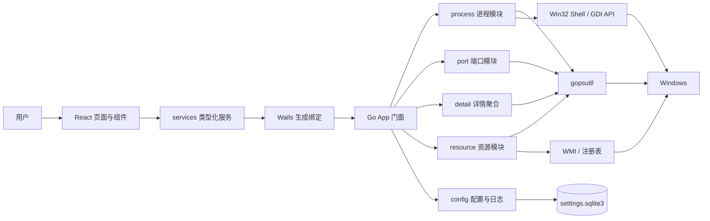

应用不使用 HTTP API。前端调用 `frontend/wailsjs/go/main/App.js` 中的生成函数，Wails 在 WebView 与 Go 进程之间完成参数序列化、方法分派和 Promise 返回值转换。生产构建时，`//go:embed all:frontend/dist` 将 Vite 产物嵌入可执行文件，因此运行时不需要单独启动 Web 服务器。

### 代码地图

| 路径 | 实现内容 | 依赖方向 |
| --- | --- | --- |
| `main.go` | Wails 窗口、静态资源、生命周期与绑定注册 | 依赖 `App` 与 Wails |
| `app.go` | 所有前端可调用方法、资源采集编排、日志写入 | 依赖全部 `internal` 模块 |
| `resource_async.go` | 一次性缓存与异步定时缓存 | 被 `app.go` 使用 |
| `cpu_model_windows.go` | CPU 型号的注册表回退读取 | 被资源采集使用 |
| `internal/process` | 进程列表、CPU 差分采样、保护判断、图标、结束进程 | 依赖 `config`、gopsutil、Win32 API |
| `internal/port` | TCP/UDP 表扫描、进程关联、按端口结束 | 依赖 `process`、`config`、gopsutil |
| `internal/detail` | 单进程快照、端口与日志聚合、开发进程识别 | 依赖 `process`、`port`、`config` |
| `internal/resource` | GPU 使用率、显存、显卡名 | 依赖 WMI 与注册表 |
| `internal/config` | SQLite schema、保护规则、Cleanup 规则、操作日志 | 底层持久化模块 |
| `frontend/src/services` | 对生成绑定的薄封装及纯前端规则算法 | 被页面调用 |
| `frontend/src/pages` | 七个页面的状态与交互 | 依赖 services、hooks、components |
| `frontend/src/hooks` | 顺序自动刷新机制 | 被动态页面复用 |
| `frontend/src/components` | 导航、状态、图标、进程名、可滚动表格 | 无业务持久化 |
| `frontend/wailsjs` | Wails 自动生成的 JS/TS 绑定与模型 | 不应手工修改 |

### 启动和生命周期

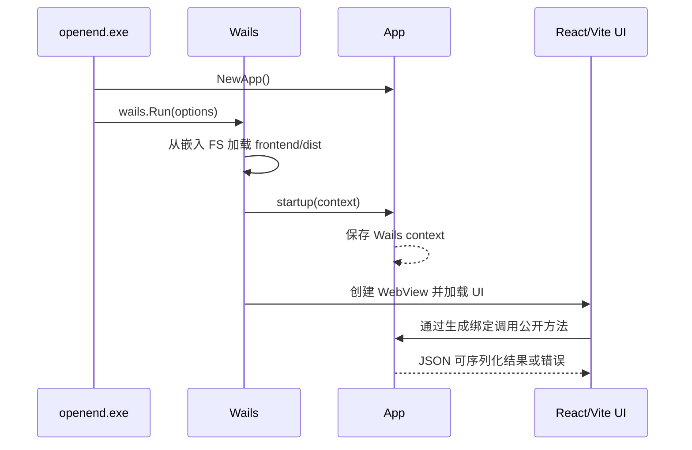

`main.go` 创建 1400×900 的窗口，最小尺寸为 960×640，使用浅色 Windows 标题栏主题。`OnStartup` 把 Wails context 保存到 `App.ctx`；若测试或非标准调用发生在启动前，`appContext()` 会回退到 `context.Background()`。当前没有 `OnShutdown` 资源需要长期释放，因为每个 SQLite 操作都使用短生命周期 `Store` 并在调用结束时关闭。

若 `wails.Run` 返回错误，入口只用 `println` 输出错误，没有显式设置非零进程退出码或弹出原生错误对话框。构建生产启动诊断时需要考虑这一行为。

## 2. Go 后端实现

### Wails 应用门面

`App` 是前端唯一可见的 Go 对象。公开方法由 Wails 生成 TypeScript 声明，业务模块本身不直接暴露给 WebView。

| Wails 方法 | 输入 | 输出 | 后端调用链 |
| --- | --- | --- | --- |
| `AppName` | 无 | 应用名 | 返回常量 `OpenEnd` |
| `GetSystemResourceInfo` | 无 | `SystemResourceInfo` | 并行调用 8 个资源采集器 |
| `GetProcessList` | 无 | `[]process.Info` | SQLite 保护规则 → `process.ListWithProtector` |
| `GetProcessDetail` | PID | `detail.ProcessDetail` | 进程快照 → 端口扫描 → 最近日志 → 聚合 |
| `GetPortList` | 无 | `[]port.Info` | SQLite 保护规则 → `port.ListWithProtector` |
| `KillProcessByPID` | PID | `OperationResult` | 保护规则 → PID 结束 → 写操作日志 |
| `KillProcessByPort` | 端口、协议 | `OperationResult` | 保护规则 → 当前所有者解析 → PID 结束 → 写日志 |
| `GetProtectionSettings` | 无 | 默认/自定义名称 | SQLite 查询 |
| `AddCustomProtectedProcessName` | 名称 | 更新后设置 | 归一化、校验、SQLite 插入 |
| `DeleteCustomProtectedProcessName` | 名称 | 更新后设置 | 校验非内置规则、SQLite 删除 |
| `GetCleanupRules` | 无 | 规则列表 | SQLite 查询并反序列化匹配器 |
| `AddCleanupRule` | 规则输入 | 更新后列表 | 归一化、校验、生成 ID、写 SQLite |
| `SetCleanupRuleEnabled` | ID、布尔值 | 更新后列表 | SQLite 更新；内置规则也可禁用 |
| `DeleteCleanupRule` | ID | 更新后列表 | 仅允许删除自定义规则 |
| `GetOperationLogs` | 无 | 最近 200 条日志 | SQLite 按时间与 ID 倒序查询 |
| `GetRecentOperationLogsForResource` | PID、名称、端口列表 | 最多 8 条相关日志 | 动态构造 OR 条件查询 |

跨 Wails 边界的核心数据契约：

| DTO | 关键字段 | 语义 |
| --- | --- | --- |
| `SystemResourceInfo` | CPU/GPU 百分比、CPU 静态信息、内存/显存字节、进程/线程/端口数、uptime | 一次系统快照；采集失败多以零值表达 |
| `process.Info` | PID、名称、图标 Data URL、路径、命令行、用户、CPU、RSS、保护标记 | 进程列表的尽力而为行数据 |
| `port.Info` | 本地端口、协议、状态、PID、进程名称/路径、保护标记 | 不包含本地 IP、远端 IP 或远端端口 |
| `detail.ProcessDetail` | 核心进程字段、开发标记、端口、最近日志及四类字段/附加源错误 | 允许部分成功的详情载荷 |
| `process.OperationResult` | `success`、`message`、PID、进程名 | 结束操作的业务结果；失败通常不是 RPC error |
| `config.ProtectionSettings` | 默认名称、自定义名称 | 前端设置页只读/可编辑两组列表 |
| `config.CleanupRule` | ID、名称、enabled/builtin、四类 matcher | 候选识别的持久化规则，不直接执行结束操作 |
| `config.OperationLog` | ID、action、PID、进程名、端口、result、message、UTC 时间 | 成功和失败结束操作的审计记录 |

门面层有两个重要约束：

1. 所有会结束进程的调用都在执行前重新从数据库加载保护规则，不能依赖前端列表中的旧 `isProtected` 值。
2. 结束操作无论成功还是失败都会尝试写日志。若结束操作本身已经完成但日志写入失败，原有 `success` 值保留，返回消息会追加 `Operation log write failed: ...`，让用户知道审计记录不完整。

### 系统资源采集与缓存

`SystemResourceInfo` 同时包含 CPU、内存、GPU、显存、进程数、线程数、占用端口数和系统运行时间。`collectSystemResourceInfo` 为 8 个采集器分别启动 goroutine，用 `sync.WaitGroup` 等待后组装快照，从而把总延迟控制在最慢的同步采集器附近，而不是各采集器耗时之和。

| 字段 | 数据源 | 执行/缓存策略 | 失败值 |
| --- | --- | --- | --- |
| CPU 使用率 | `gopsutil/cpu.Percent(0, false)` | 每次同步采集，保留 1 位小数 | `0` |
| CPU 型号/核数/频率 | `cpu.Info`、`cpu.Counts`；型号回退到注册表，Windows 频率/物理核数回退到仅查询必需字段的 WMI | 首次同步采集，字段完整后进程期内缓存；不完整时下次请求重试 | 空字符串或 `0`，采集错误写入日志 |
| 内存 | `mem.VirtualMemory` | 每次同步采集；可用内存取 `Available` | 全部 `0` |
| GPU 使用率/已用显存/名称 | WMI 性能计数器与控制器 | 后台刷新，最短间隔 5 秒 | 缓存值或零值 |
| 总显存 | 显卡注册表，失败后 WMI `AdapterRAM` | 首个正值进程期内缓存 | `0` |
| 进程数 | `process.Pids` | 每次同步采集 | `0` |
| 线程数 | 遍历进程并累加 `NumThreads` | 后台刷新，最短间隔 5 秒 | 缓存值或 `0` |
| 端口数 | `net.Connections("inet")` 后按本地端口号去重 | 后台刷新，最短间隔 10 秒 | 缓存值或 `0` |
| 运行时间 | `host.Uptime` | 每次同步采集 | `0` |

这里有两种泛型缓存：

- `cachedResourceCollector[T]` 在第一次 `Get()` 时同步执行，通过可选的 `valid` 检查后永久返回缓存值。CPU 静态信息要求型号、频率、物理核数和逻辑处理器数全部有效；不完整时返回已取得的字段，下次 `Get()` 重试。
- `asyncCachedCollector[T]` 在满足最短刷新间隔且没有在途任务时启动后台 goroutine，当前调用立即返回上一份缓存；还没有缓存时返回类型零值。GPU、线程数和端口数使用此策略。

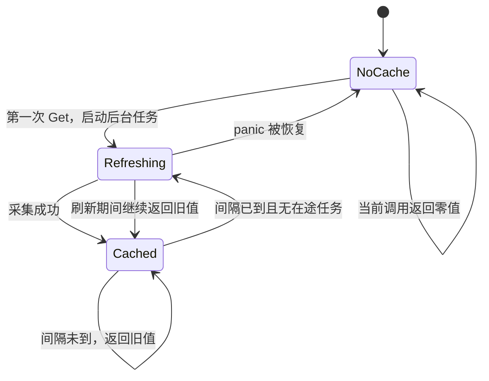

`inFlight` 保证同一采集器只有一个后台任务，互斥锁保护缓存、开始时间和状态。`runResourceCollector` 会恢复采集器 panic，失败值不会覆盖已有缓存。代价是首次打开性能页时，异步字段可能短暂显示为 0；下一次前端刷新会读取后台完成后的值。

GPU 的实现是“尽力而为”：

- 查询 `Win32_PerfFormattedData_GPUPerformanceCounters_GPUEngine`，累加所有引擎的 `UtilizationPercentage` 后夹在 0–100。
- 查询 `GPUAdapterMemory`，累加各项 `DedicatedUsage` 作为已用显存。`SharedUsage` 与 `TotalCommitted` 当前只进入结构体，没有参与界面值计算。
- 显卡名称来自 `Win32_VideoController`，去空、去重但保持发现顺序。
- 总显存先遍历显示适配器注册表类下 `0000`–`0099` 的 `HardwareInformation.qwMemorySize`，没有结果再累加 WMI `AdapterRAM`。
- 可用显存只在 `total > used` 时计算为差值；若驱动计数导致已用值超过总值，则为 0，不会发生无符号下溢。

### 进程模块

`internal/process` 把“读取进程”和“结束进程”分离，并通过 `Protector` 接口注入保护规则，便于测试和复用。

进程列表扫描过程如下：

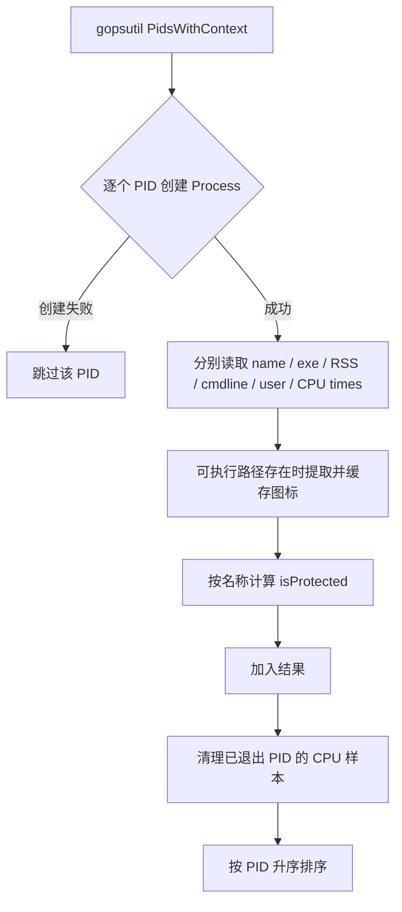

单个字段读取失败不会丢弃整行，对应字段保留零值或空字符串。内存取 RSS；进程名读取失败时会从可执行路径的 basename 回填。如果系统返回了 PID，但所有 PID 都无法创建进程对象，函数返回明确错误，避免前端把权限问题误判成“没有进程”。

进程 CPU 不是直接采用瞬时接口，而是保存每个 PID 的上次累计 CPU 时间：

```text
rawPercent = (本次累计 CPU 秒 - 上次累计 CPU 秒) / 两次采样墙钟秒 × 100
systemPercent = clamp(rawPercent / 逻辑处理器数量, 0, 100)
```

第一次看到某个 PID 时没有差分基线，因此 CPU 为 0；之后的列表刷新才会得到有效值。样本表由互斥锁保护，扫描结束后删除本轮未出现的 PID，避免进程退出后缓存无限增长。NaN、Inf、时间倒退或 CPU 累计值不增都归零。

#### 可执行文件图标

Windows 图标路径经过 trim、`filepath.Clean` 和小写归一化后作为缓存键。实现依次调用：

1. `SHGetFileInfoW` 获取小图标句柄；
2. `GetIconInfo` 与 `GetObjectW` 取得颜色位图信息；
3. `GetDIBits` 读取 32 位 BGRA 像素，并用负高度获得自上而下的位图；
4. 转换为 RGBA，编码 PNG，再拼成 `data:image/png;base64,...`；
5. 释放 icon、bitmap 和 device context 等 Win32 资源。

缓存最多 256 个路径；达到上限时整体清空，再写入新结果。提取失败也缓存为空字符串，前端据此显示进程名首字母。该策略避免列表每 5 秒刷新时重复调用昂贵的 Shell/GDI API。

#### 结束进程

`KillByPIDWithProtector` 的校验顺序是：context → PID 必须大于 0 → 重新枚举 PID 确认目标仍存在 → 读取当前进程名 → 检查保护规则 → `gopsutil.Process.KillWithContext`。这既降低列表陈旧导致的误操作，也保证保护判断使用结束瞬间读到的名称。

保护匹配由 `NormalizeProcessName` 完成：去空、取 basename、转小写。因此 `C:\\Windows\\System32\\svchost.exe`、`SVCHOST.EXE` 与 `svchost.exe` 会命中同一规则。内置名单不能删除，自定义名单与内置名单合并后参与扫描和结束操作。

`process.IsProtectedName` 这个便捷函数在 SQLite 规则加载失败时会退回仅检查内置名单；正式的 App 列表和结束入口更保守，保护配置无法加载时会直接失败，不继续扫描或结束。

当读取或结束进程返回 `windows.ERROR_ACCESS_DENIED` 时，结果会明确建议以管理员身份运行；其他错误保留底层原因。当前执行的是强制结束单个 PID，不会发送优雅退出信号、等待超时或递归结束子进程。

### 端口模块

端口扫描分别调用 `gopsutil/net.ConnectionsWithContext(ctx, "tcp")` 与 `"udp"`。任一协议查询失败都会让整个扫描失败，并在消息中提示 Windows 连接表权限问题。扫描成功后只为连接表中实际出现的 PID 建立进程索引，避免遍历全部系统进程。

每条端口记录包含本地端口、协议、状态、PID、进程名、进程路径和保护标记。实现细节如下：

- 本地端口为 0 的记录被忽略。
- UDP 没有状态时规范为 `LISTEN`；TCP 空状态规范为 `UNKNOWN`。
- 去重键为 `协议:端口:PID:状态`，所以绑定在多个本地地址但其余字段相同的记录只显示一次。
- 排序键依次为端口、协议、PID、状态。
- TCP/UDP 查询都成功但没有一条可读端口时返回错误，而不是空列表。

模型刻意不保存本地 IP、远端 IP 或远端端口，因此界面表达的是“本机端口与进程的占用关系”，不能用于完整连接会话分析。

按端口结束不会盲目使用列表中的 PID。它重新读取指定协议的连接表，按本地端口收集去重后的正 PID：

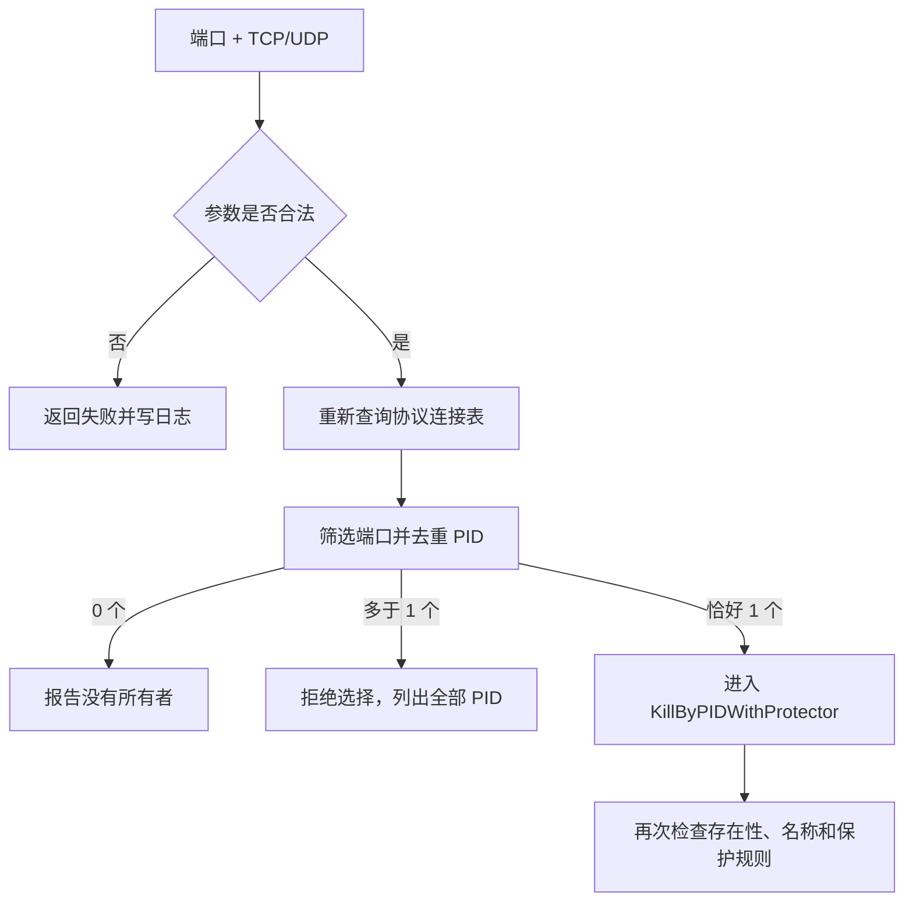

拒绝多所有者端口是安全设计：同一端口在不同地址、复用或特殊网络状态下可能关联多个进程，应用不会自行猜测应结束哪一个。

按端口结束只显式校验端口大于 0，没有额外校验上限 65535；超范围正数通常会落到“没有所有者”。它也不按 TCP 状态筛选，监听、已连接等任何同本地端口记录都会参与 PID 解析。

### 进程详情聚合

`GetProcessDetail` 分三步读取并合并数据：

1. `ReadProcessSnapshot` 获取名称、图标、路径、命令行、RSS、CPU 与保护状态；PID 无效或进程对象无法创建属于致命错误。
2. 扫描当前端口，并从 SQLite 读取与 PID 或进程名相关的最近 8 条日志；这两项是可降级的附加数据。
3. `BuildProcessDetail` 筛出同 PID 的端口、去重排序，计算“开发相关”标记，并保留每个附加数据源的错误字符串。

可执行路径或命令行因权限无法读取时不会让详情页整体失败，而是写入 `executablePathError` / `commandLineError`。端口和日志失败分别进入 `portsError` / `logsError`，前端可以在仍展示核心快照的同时解释缺失原因。

开发相关识别会把名称、路径和命令行转小写后切成 token，再与 Node、npm、pnpm、yarn、Vite、Python、uvicorn、Go、Java、Redis、Postgres、MySQL、Nginx、Docker、WSL、vmmem 等关键字匹配。匹配考虑 `.exe` 和常见 `name.` / `name-` 变体，避免单纯任意子串造成过多误报。这个标记只用于详情展示；Cleanup 候选由可配置规则另行计算。

### 本地配置与 SQLite

数据库路径由 `os.UserConfigDir()` 解析后拼为 `OpenEnd/settings.sqlite3`；Windows 通常位于用户的 AppData 配置目录。父目录以仅用户访问为意图创建。数据库使用纯 Go 的 `modernc.org/sqlite` 驱动，不依赖外部 SQLite DLL。

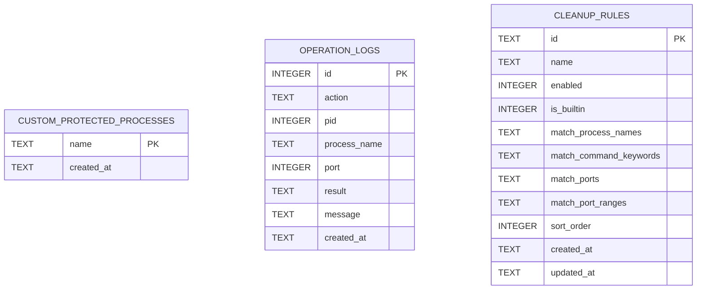

`NewStore` 的初始化策略：

- 路径为空直接失败，避免意外打开内存库或错误位置。
- `SetMaxOpenConns(1)` 把每个 `Store` 限制为单连接，降低 SQLite 锁竞争。
- 进程级 `storeInitializeMu` 串行化 schema 创建与默认规则播种，支持多个 Wails 调用并发首次打开数据库。
- `CREATE TABLE/INDEX IF NOT EXISTS` 和内置规则 `ON CONFLICT(id) DO NOTHING` 让初始化幂等；用户已经禁用的内置规则不会被下次打开重置。
- 当前门面层每次操作打开、初始化并关闭一个 `Store`，没有长连接或显式迁移版本表。
- 建表、索引创建和默认规则播种没有包在同一事务中；中途失败可能留下部分 schema，但幂等语句允许下次打开继续补全。
- 目录创建传入 `0700` 是仅用户访问的设计意图；Windows 不提供与 POSIX mode 完全相同的权限保证。

三类数据的规则如下：

| 数据 | 规范化/校验 | 删除与更新策略 |
| --- | --- | --- |
| 自定义保护进程 | trim、basename、小写；不能为空，不能重复内置项 | 自定义项可删；内置项只存在代码中且不可删 |
| Cleanup 规则 | 名称不能为空；至少一个匹配器；字符串去空、转小写、去重排序；端口必须 1–65535；范围起点不得大于终点 | 内置/自定义都可启停；只有自定义规则可删除 |
| 操作日志 | `action`、`result` 不能为空；时间写 UTC RFC3339Nano | 只追加；列表最多返回最新 200 条，当前无自动清理 |

Cleanup 的四条内置规则覆盖 Node/Vite、Python、Go 和数据库进程。自定义规则 ID 使用 8 个加密随机字节编码为 `custom-` 加 16 位十六进制字符串。四组匹配器以 JSON 数组保存在 SQLite TEXT 列中，读取时再反序列化为 Go/TypeScript 结构。

| 内置 Cleanup 规则 | 默认进程名匹配 | 默认端口匹配 |
| --- | --- | --- |
| Node/Vite | `node.exe`、`npm`、`pnpm`、`yarn`、`vite` | 3000、5173、5174 |
| Python | `python.exe`、`uvicorn` | 5000、8000 |
| Go | `go.exe` | 8080 |
| Database | `redis-server`、`postgres`、`mysql` | 6379、5432、3306 |

内置保护名单共 15 项：`System`、`Registry`、`smss.exe`、`csrss.exe`、`wininit.exe`、`winlogon.exe`、`services.exe`、`lsass.exe`、`svchost.exe`、`explorer.exe`、`dwm.exe`、`taskhostw.exe`、`RuntimeBroker.exe`、`SecurityHealthService.exe`、`MsMpEng.exe`。显示时保留原始大小写，匹配时统一成 basename 小写。

操作日志对资源的关联查询采用 OR 语义：PID 相同、进程名大小写无关相同、或端口命中任一条件即算相关；端口先移除非正数和重复值。没有任何有效条件时直接返回空切片，不执行无界查询。

## 3. React 前端实现

### 入口、导航与状态边界

前端入口很薄：`index.html` 提供 `#root`，`main.tsx` 使用 React 18 `createRoot` 并启用 `StrictMode`。`App.tsx` 只保存两个全局状态：当前页面 ID 与语言；项目没有 React Router、Context、Redux 或其他状态库。

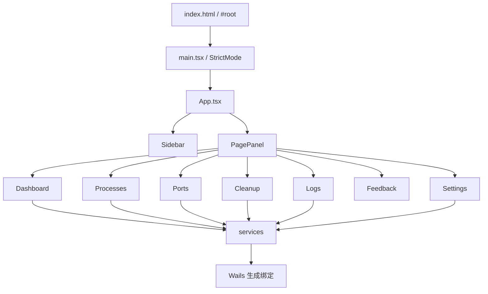

页面定义由 `getPages(t)` 根据当前翻译函数生成。`PagePanel` 使用明确的条件分发渲染七个页面，而不是 URL 路由。`workspace-body` 以页面 ID 作为 React `key`，切换页面会卸载原页面并重新创建，因此页面的筛选条件、选中项、弹窗、历史曲线与轮询计时都会重置；导航栏自身的折叠状态保留。

语言支持中文和英文：

- 初始值先读 `localStorage.openend-language`；值无效或不存在时，浏览器语言以 `zh` 开头则选中文，否则选英文。
- 切换语言会更新顶层 state、写回 localStorage，并同步修改 `<html lang>`。
- 英文翻译对象定义合法 key 联合类型，中文对象声明为相同 key 的 `Record`，因此缺少翻译会在 TypeScript 编译阶段报错。
- 翻译函数是直接字典读取，没有插值、复数规则或运行时回退。

### Wails 服务与类型层

页面不直接访问 `window.go.main.App`，而是通过 `services/*.ts`。这些服务主要提供三个价值：隔离生成代码路径、约束本地领域类型、集中通用格式化/纯函数。

| 服务 | 作用 | 对应绑定 |
| --- | --- | --- |
| `systemResources.ts` | 获取资源、格式化字节/百分比、1 GiB 高内存阈值 | `GetSystemResourceInfo` |
| `processes.ts` | 列表、详情、按 PID 结束 | `GetProcessList`、`GetProcessDetail`、`KillProcessByPID` |
| `ports.ts` | 列表、按端口结束、常见开发端口判断 | `GetPortList`、`KillProcessByPort` |
| `logs.ts` | 全部日志与资源相关日志 | `GetOperationLogs`、`GetRecentOperationLogsForResource` |
| `settings.ts` | 保护设置与 Cleanup 规则 CRUD | 7 个设置类绑定 |
| `cleanup.ts` | 在本地把进程、端口和规则计算成候选项 | 无直接 RPC，是纯前端算法 |
| `pages.ts` | 导航元数据和默认页面 | 无 RPC |
| `i18n.ts` | 语言解析与翻译字典 | 无 RPC |

`frontend/src/types` 中的 interface 与 `frontend/wailsjs/go/models.ts` 采用 TypeScript 结构类型兼容。新增 Cleanup 规则时，服务显式调用生成模型的 `config.CleanupRuleInput.createFrom(input)`，以恢复嵌套端口范围模型；其他方法仅使用基本参数或直接接收返回对象。

`frontend/wailsjs` 是 Wails 生成物，每个函数最终转发到 `window.go.main.App.<Method>`。该目录文件头明确标注不可手工修改；Go DTO 或公开方法变化后，应通过 Wails 工具重新生成绑定，再调整本地 types 与 services。

### 顺序自动刷新

`useSequentialAutoRefresh` 被所有动态页面复用。它使用递归 `setTimeout`，而不是 `setInterval`：只有当前 loader 完成后才开始计算下一次间隔。因此慢请求不会堆积成并发队列。

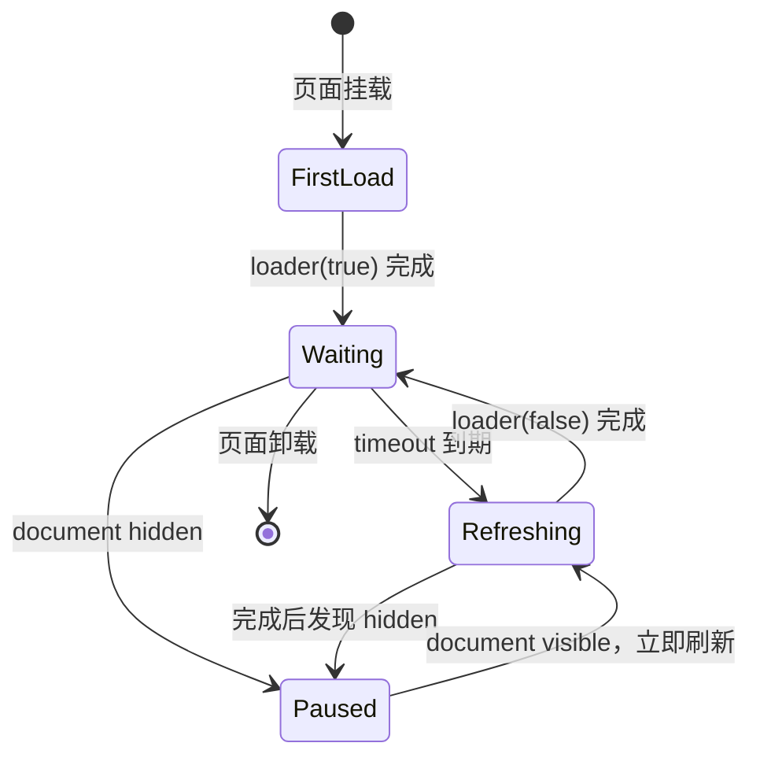

实现用 `activeRefreshRef` 保存唯一在途 Promise，即使 StrictMode 重放 effect、刷新周期变化或可见性事件交错，也不会重叠请求。`loaderRef` 始终指向最新函数，但 loader 引用变化不会重启定时器。页面隐藏时清除定时器；恢复可见立即刷新。未被页面 loader 捕获的异常会输出到 `console.error`，随后仍安排下一轮。

| 页面 | 周期 | 必需请求 | 可降级辅助请求 |
| --- | ---: | --- | --- |
| Dashboard | 1 秒 | 系统资源 | 无 |
| Processes | 5 秒 | 进程列表 | 端口列表 |
| Ports | 5 秒 | 端口列表 | 进程列表 |
| Cleanup | 5 秒 | 进程、端口、Cleanup 规则三者都必需 | 无 |
| Logs | 5 秒 | 操作日志 | 无 |
| Settings | 10 秒 | 保护设置与 Cleanup 规则都必需 | 无 |

首次调用传 `showLoading=true`；后台刷新传 `false`，避免每轮轮询闪烁 loading。各页面仍自行决定失败时保留旧数据还是清空。

### 页面实现

| 页面 | 状态与数据流 | 主要交互与降级策略 |
| --- | --- | --- |
| Dashboard | 保存最新 `SystemResourceInfo`、最多 61 个/60 秒历史样本、当前资源类别、loading/error | 每秒采样；CPU/GPU 与内存/显存比率统一夹到 0–100；失败时保留旧快照和曲线并显示错误 |
| Processes | 进程、辅助端口、名称/PID 筛选、CPU/内存排序、详情、右键菜单、结束确认 | 进程为主请求，端口失败不阻断；点击/键盘/右键打开详情；保护项禁用结束；成功后刷新列表 |
| Ports | 端口、辅助进程、四类筛选、详情、相关日志、右键菜单、结束确认 | 端口为主请求；进程数据补充图标/CPU/内存/命令；按端口结束成功后刷新并更新或关闭详情 |
| Cleanup | 三份源数据、候选、复选 PID、详情、相关日志、单项/批量确认 | 候选纯前端计算；批量结束串行执行，单项异常不阻断后续，最终汇总成功/失败并刷新 |
| Logs | 最新日志、loading/error | 每 5 秒整体替换；仅 `result === "success"` 显示成功样式；时间本地化 |
| Settings | 保护设置、规则、五个表单字段、保存状态与提示 | 默认保护项只读；自定义项增删；内置规则可启停不可删；前后端都校验规则输入 |
| Feedback | 无动态 state | 生成 URL 编码的 `mailto:` subject/body，由系统默认邮件客户端处理 |

#### Dashboard

采样写入 `{time,cpu,memory,gpu,vram}`：CPU/GPU 直接使用百分比，内存/显存由 `used / total × 100` 得出。历史只保留当前时间前 60 秒并再次限制到 61 个样本。曲线没有引入图表库，而是把时间映射到 SVG x=0–100、使用率映射到 y=100–value，用 `polyline` 与闭合 `path` 绘制。

主图支持鼠标选择最近采样点、焦点进入时显示最新点、左右方向键逐点浏览、十字线与 tooltip；迷你图与主图共享相同坐标计算。不同资源切换时展示不同详情字段，例如 CPU 型号/核数/频率，或显存总量/使用量。

#### Processes

`Promise.all` 同时请求进程与端口，但端口 Promise 自行 catch 为 `[]`，所以端口权限问题不会清空进程主列表。过滤后的列表先按进程名不区分大小写包含匹配、再按 PID 字符串包含匹配，最后按内存或 CPU 降序排列。

详情是独立的 `GetProcessDetail(pid)` 请求，包含字段级权限错误、相关端口与最近日志。5 秒列表刷新不会自动重载已经打开的详情。行支持鼠标点击与 Enter/Space；右键菜单在窗口点击、Escape 或新的右键动作时关闭。

结束按钮会先在 UI 层排除受保护进程，再显示包含 PID、名称等信息的确认框，最后调用后端。UI 检查只改善体验，真正安全边界仍是后端在操作瞬间重新加载的保护规则。

#### Ports

端口筛选支持端口号子串、进程名、TCP/UDP 和动态状态集合。端口行身份由协议、端口、PID、状态组合。辅助进程列表按 PID 建索引，用于补齐端口扫描没有携带的图标、CPU、内存和启动命令。

打开详情时额外请求 `GetRecentOperationLogsForResource(pid, processName, [port])`，界面只展示前 5 条。常见开发端口标记来自前端固定集合：3000、5173、8000、8080、5432、3306、6379。按端口结束同样先确认；后端会重新解析当前所有者，拒绝零个或多个所有者。

#### Cleanup

Cleanup 不在后端维护候选列表。页面每 5 秒并行获取进程、端口和规则，再调用 `buildCleanupCandidates`：

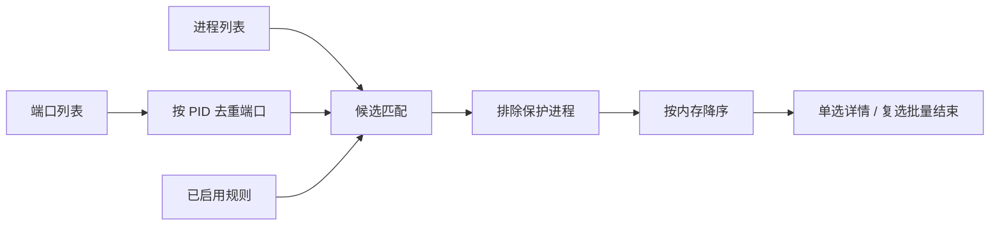

匹配语义非常重要：

- 一条规则中的进程名、命令关键字、明确端口、端口范围为 OR；命中任何一项即可入选，并记录所有命中原因。
- 多条规则也为 OR，候选保留全部命中规则。
- 进程名匹配会取路径末段并小写，兼容无 `.exe` 规则与 `name.exe`、`name.*`、`name-*` 形式。
- 命令关键字使用小写后的 `includes`；端口范围是闭区间。
- 保护进程在候选生成前排除，标记为受保护的端口也不进入 PID 端口索引。
- 最终候选按内存占用降序排列。

批量结束按当前候选顺序逐个 `await KillProcessByPID`，不是并发 Promise。这样每个操作都单独经过后端安全检查和日志记录；某一项抛异常时只计为该项失败，不中止余下任务。结束前始终有二次确认。

#### Settings、Logs 与 Feedback

设置表单先在前端把逗号分隔文本解析为数组，端口要求 1–65535 整数，范围要求 `start-end` 且起点不大于终点，四类匹配器不能全空。后端会再次规范化并校验，不能把前端校验当成安全边界。共享 `isSaving` 使任一写操作期间所有写按钮不可用。删除自定义保护项或 Cleanup 规则当前不再弹二次确认。

日志页展示后端最近 200 条记录，浏览器把合法 RFC3339 时间转成本地字符串；日期无效则显示原值。反馈页没有上传接口，只构造 `mailto:`。点击后数据是否发送、发送到哪里由用户的邮件客户端决定。

### 通用组件、可访问性与样式

| 组件 | 实现方法 |
| --- | --- |
| `Sidebar` | 自持折叠状态；按钮导航使用 `aria-current`、`aria-expanded`；设置项通过布局固定到底部 |
| `Icon` | 本地 SVG path 表，不依赖外部图标包 |
| `ProcessNameCell` | 优先 data URL 图标；缺失时显示进程名首字母；名称也缺失时显示调用方 fallback |
| `StatusMessage` | 统一 loading/error/empty/success，错误状态使用 `role=alert` |
| `ScrollableDataTable` | 表格与底部独立横向滚动条双向同步；支持 ResizeObserver 与键盘滚动 |

`ScrollableDataTable` 在内容变化后用 layout effect 重测 `scrollWidth`，优先监听 `ResizeObserver`，旧环境回退到 window resize。自定义滚动条提供 `role="scrollbar"`、ARIA 当前值，并支持 Left/Right、Home/End、PageLeft/PageRight。

样式全部是全局 CSS，无 UI 框架、CSS Modules 或 CSS-in-JS。`App.css` 用 CSS 变量统一颜色、边框、状态色和行高；1100px 以下收窄侧栏/详情，800px 以下强制图标侧栏并让详情覆盖表格。Dashboard 使用独立 CSS，在 700px 以下把资源选择区改为顶部横向布局。

大多数页面文案和 ARIA 标签经过 i18n；目前仍有少量实现字符串未翻译，例如表格滚动条标签中的 `horizontal scroll`、进程图标标签中的 `icon`，以及 Cleanup 服务生成的英文命中原因。

## 4. 关键端到端流程

### 结束进程并记录审计日志

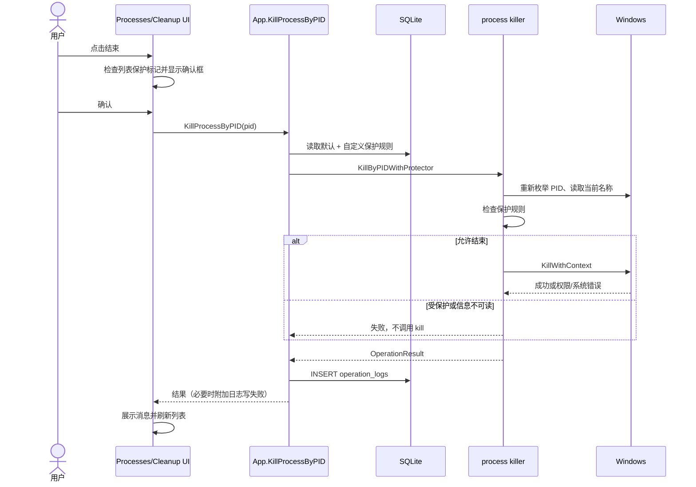

按端口结束在进入这条流程前多一步“重新查询连接表并要求唯一 PID”。因此列表保护标记、前端确认、端口唯一所有者检查、后端进程名保护检查构成多层防护。

### 进程详情读取

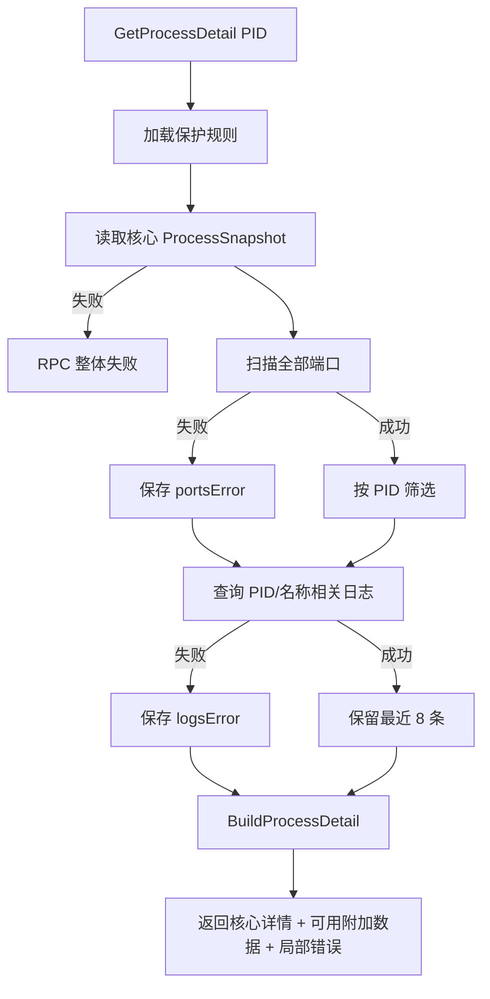

这种“核心数据硬失败、附加数据软失败”模式让详情页在端口表权限不足或数据库暂时不可用时仍能展示进程基本信息。

### 资源页刷新链

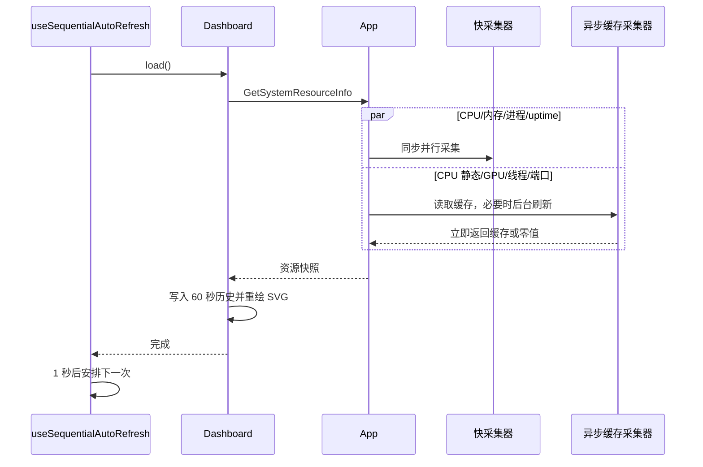

## 5. 横切设计：安全、并发、错误与平台

### 安全和本地数据

| 控制点 | 当前实现 |
| --- | --- |
| 危险操作确认 | Processes、Ports、Cleanup 单项/批量操作都先显示确认框 |
| 后端授权判断 | 结束瞬间重新加载保护规则、读取当前进程名并 fail-closed 检查 |
| 多 PID 端口 | 明确拒绝自动选择 |
| 权限错误 | Windows access denied 转为管理员提示，不自动请求提权 |
| Shell 注入面 | 扫描和结束不执行 `taskkill`、`netstat`、PowerShell 或 `exec.Command` |
| SQL 注入面 | 值全部使用参数化查询；动态日志条件只拼固定片段和占位符 |
| 数据位置 | 设置与日志写入用户本地 SQLite；语言写 localStorage |
| 网络/云 | 核心功能没有 HTTP 客户端或云同步；反馈页只交给本机邮件客户端 |

应用能读取路径、命令行、用户名和资源占用，这些信息可能敏感，但当前只在本地 WebView 展示和本地日志中记录操作结果。SQLite 日志会持续累积，若机器共享或需满足数据保留要求，应增加显式清理/保留策略。

### 一致性、缓存和竞态

- 前端列表是周期快照，操作前后都可能过时；后端通过重新枚举 PID、重新读取名称和重新查端口所有者缩小窗口。
- PID 存在性检查、名称读取与 kill 不是一个原子操作，仍有 PID 复用的 TOCTOU 风险。当前未校验进程创建时间，也未持有原生进程句柄贯穿检查和结束。
- 端口解析后到 PID 结束前，端口归属也可能变化；进程模块会复核 PID/名称/保护，但不会再次确认该 PID 仍占用原端口。
- CPU 列表采样以 PID 为缓存键；PID 极快复用通常因累计 CPU 下降归零，但理论上可能产生一次被夹到 100% 的尖峰。
- 资源异步采集没有 timeout。若底层调用永久阻塞，`inFlight` 会一直为 true，缓存停留在旧值或零值。
- SQLite 初始化在当前进程内串行，但普通操作、不同 `Store` 和不同 OpenEnd 进程之间没有额外锁；未显式启用 WAL、busy timeout 或写入重试。

### 错误模型

| 类别 | 对外表达 | UI 行为 |
| --- | --- | --- |
| 列表/设置读取失败 | Go `error` → Promise reject | 页面显示本地化通用错误；是否清空旧数据由页面决定 |
| 结束操作失败 | `OperationResult{success:false,message}`，通常不 reject | 显示后端具体原因，并保留审计能力 |
| 详情核心失败 | Promise reject | 详情错误状态 |
| 详情附加源失败 | `portsError` / `logsError` 字段 | 继续显示核心详情和其他成功部分 |
| 系统资源采集失败 | 字段零值，无 error | Dashboard 无法区分真实 0、权限失败与不支持 |
| 图标失败 | 空字符串 | 首字母 fallback |
| 日志写入失败 | 原操作结果消息追加说明 | 用户知道操作与审计记录可能不一致 |

错误消息目前存在双轨：页面级通用文案来自 i18n，后端 `OperationResult` 和字段级错误是英文字符串。若要实现完全本地化，建议让后端返回稳定错误码与结构化上下文，由前端翻译，而不是翻译任意错误句子。

### 平台实现

构建标签把 Windows 与非 Windows 实现分开：

| 能力 | Windows | 非 Windows |
| --- | --- | --- |
| 进程/端口扫描 | gopsutil 实现 | 返回明确 unsupported error |
| PID/端口结束 | gopsutil kill + Windows 权限识别 | 返回失败 `OperationResult` |
| 进程详情 | gopsutil + 图标 | 返回 unsupported error |
| 图标 | Shell/User/GDI API | 空字符串 |
| GPU | WMI + 注册表 | 全零 `GPUInfo` |
| SQLite 配置 | 可用 | 代码可运行，但默认规则明显面向 Windows |

因此项目虽然部分包可跨平台编译，当前产品能力和发布链仍以 Windows 10/11 为目标。

## 6. 测试、构建与发布

### 测试结构与当前基线

| 测试层 | 主要覆盖 | 当前结果 |
| --- | --- | --- |
| `app_test.go` | 资源并行、缓存、进程/端口集成、失败日志、保护设置门面 | 通过 |
| `internal/config/store_test.go` | 保护 CRUD、默认规则播种、并发初始化、日志过滤/上限 | 通过 |
| `internal/process/*_test.go` | CPU 差分、保护规则、结束分支、当前进程扫描 | 通过 |
| `internal/port/*_test.go` | 临时 TCP/UDP listener、按端口结束分支 | 通过 |
| `internal/detail/process_detail_test.go` | 聚合、端口排序、错误保留、开发进程识别 | 通过 |
| `internal/resource/gpu_test.go` | GPU 聚合、显存计算与成功缓存 | 通过 |
| `App.test.tsx` | 七页关键交互、筛选、确认、刷新、错误状态 | 36 项通过 |
| `useSequentialAutoRefresh.test.tsx` | 可见性、StrictMode、顺序执行、异常恢复 | 9 项通过 |
| `cleanup.test.ts` | 四类规则匹配、保护排除、排序与原因 | 1 项通过 |

本次文档编写时实际执行：

```powershell
go test ./...
npm --prefix frontend test
npm --prefix frontend run build
```

结果为 Go 6 个包全部通过、前端 3 个测试文件共 46 项通过、TypeScript 与 Vite 生产构建成功。当前 Go 语句覆盖率约为：根包 56.5%、config 70.6%、detail 43.3%、port 74.2%、process 74.6%、resource 37.4%；项目没有配置强制覆盖率阈值。

较明显的测试空白包括真实 WMI/注册表失败、Win32 图标句柄路径、非 Windows 行为、PID 复用/端口归属竞态、SQLite 锁冲突、资源采集 timeout、真实 ResizeObserver/视觉响应式和模态框焦点圈闭。

### 本地开发

环境要求：Windows 10/11、Go 1.24+、Node.js 22.x（推荐）、npm、Wails CLI v2.12.0。首次安装：

```powershell
go install github.com/wailsapp/wails/v2/cmd/wails@v2.12.0
npm --prefix frontend install
```

热重载启动：

```powershell
wails dev
```

前端单独命令：

```powershell
npm --prefix frontend run dev
npm --prefix frontend test
npm --prefix frontend run build
```

Vite 生产命令先执行严格 TypeScript 检查，再打包：`tsc && vite build`。配置使用 ESNext、`strict`、`isolatedModules`、`noEmit`；测试环境为 jsdom，并加载 jest-dom matcher。React 插件关闭 Fast Refresh，由 Wails/Vite 开发链负责页面更新。

### Windows 构建和安装包

```powershell
.\scripts\build-windows.ps1
.\scripts\package-windows.ps1
```

两个脚本都在执行前检查 Go、npm 和 Wails；打安装包的脚本还默认检查 `makensis`。它们接受目标平台、WebView2 策略、是否跳过 clean、额外 Wails 参数等选项，并在失败退出码时抛错。

| 脚本 | 核心命令 | 产物 |
| --- | --- | --- |
| `build-windows.ps1` | `wails build -platform windows/amd64 -webview2 download -clean` | `build/bin/openend.exe` |
| `package-windows.ps1` | 上述命令加 `-nsis` | exe 与 `*installer.exe` |

`wails.json` 定义应用名/输出名 `openend`、产品版本 2.1.2、`nsisType: multiple`，前端安装/构建命令分别为 `npm install` 与 `npm run build`。默认 WebView2 策略为 download；改成 embed 可用于离线安装，但会增大安装包。

仓库中的 GitHub Actions 工作流在 `main` push 或手动触发时使用 Windows runner，使用 `npm install` 安装依赖，安装 Go、Node 22、Wails 2.12、NSIS，再生成并保留 14 天的未签名 artifact `dev-resource-manager-windows-unsigned`。工作流当前没有单独执行 `go test` 或 `npm test`，测试仍需在发布前本地或后续 CI 步骤中保证。当前安装包没有代码签名，公开分发前需要按 `docs/release-windows.md` 的预留流程接入证书并在干净环境验证安装、启动和卸载。

## 7. 维护与扩展指南

### 新增后端能力

1. 在合适的 `internal/<domain>` 中实现纯领域或平台函数；Windows 专有实现使用 `//go:build windows`，同时提供非 Windows 文件。
2. 在 `App` 添加可导出的薄门面方法，统一 context、保护规则、Store 生命周期和错误语义。
3. 运行 Wails 生成流程（通常随 `wails dev`/build 更新）以刷新 `frontend/wailsjs`；不要手改生成文件。
4. 在 `frontend/src/types` 定义稳定的 UI 类型，在 `services` 封装生成调用，再由页面使用。
5. 同时增加 Go 单元测试和前端 mock/交互测试；危险操作必须覆盖保护、权限、陈旧目标和日志失败分支。

### 新增页面

需要同步修改 `types/navigation.ts` 的 `PageId`、`services/pages.ts` 的元数据、`PagePanel.tsx` 的分发、`Icon.tsx` 的图标映射、两种语言翻译、样式与 App 集成测试。若页面有轮询，优先复用 `useSequentialAutoRefresh`，并明确哪些请求是主数据、哪些允许降级。

### 新增资源指标

后端先扩展 `SystemResourceInfo` 与采集器集合，再判断指标属于：

- 快速动态值：每次同步采集；
- 昂贵动态值：`asyncCachedCollector`，明确刷新间隔和首帧零值；
- 静态硬件值：`cachedResourceCollector` 或模块内成功缓存。

随后更新生成模型、本地 `SystemResourceInfo`、Dashboard 样本/指标/图表和资源并发测试。若指标可能失败，优先增加结构化可用性/错误字段，不要继续用 0 同时代表“真实为零”和“读取失败”。

### 演进 Cleanup 规则

规则数据定义和持久化在 Go，候选匹配在 TypeScript，因此新增匹配器需要同时修改：Go DTO/规范化/schema、生成模型、本地 types、设置表单、`cleanup.ts`、匹配原因、i18n 与两端测试。

当前内置规则使用 `ON CONFLICT DO NOTHING` 播种；同 ID 的代码规则以后发生变化，不会更新已有用户数据库。若需要修改默认规则或数据库结构，应先引入 schema/version 迁移机制，明确保留用户启停状态的合并策略。

### 建议优先偿还的技术债

| 优先级 | 项目 | 原因 |
| --- | --- | --- |
| 高 | 用原生进程句柄/创建时间缩小 PID 复用窗口 | 属于危险操作正确性边界 |
| 高 | 为资源采集增加 timeout、错误码和可用性状态 | 避免永久在途与“0 值歧义” |
| 中 | 增加 SQLite schema 版本、事务迁移、busy timeout 与日志保留策略 | 支撑长期升级和并发稳定性 |
| 中 | 把 Cleanup 匹配原因及后端错误结构化、本地化 | 消除中英文混合与字符串耦合 |
| 中 | 为 WMI、注册表、图标和权限失败添加可注入接口测试 | 当前 Windows 特有路径覆盖偏低 |
| 低 | 消除本地 interface 与生成模型的重复定义 | 降低 DTO 漂移风险 |
| 低 | 补全弹窗焦点圈闭与实际视觉回归 | 提升键盘可访问性和响应式可靠性 |

当前还应注意三处实现级不一致：Dashboard 实际每 1 秒刷新，但翻译文案写“每 3 秒更新”；常见开发端口的前端徽标集合少于默认 Cleanup 规则中的端口集合；发布文档把 CI artifact 写成 `openend-windows-unsigned`，但工作流实际使用 `dev-resource-manager-windows-unsigned`。它们不会破坏核心操作，但修改相关体验时应统一来源。

## 8. 关键约束速查

| 问题 | 当前答案 |
| --- | --- |
| 是否需要后端服务或开放端口？ | 不需要；Wails 进程内绑定通信 |
| 是否上传系统信息？ | 核心功能不上传；反馈按钮只打开本地邮件客户端 |
| 配置和日志在哪里？ | `os.UserConfigDir()/OpenEnd/settings.sqlite3` |
| 保护规则何时生效？ | 每次列表与结束操作时从 SQLite 重新加载 |
| 结束端口占用会结束多个 PID 吗？ | 不会；多 PID 时拒绝操作 |
| Cleanup 会自动后台结束进程吗？ | 不会；只生成候选，用户确认后逐项结束 |
| 操作失败会记日志吗？ | 会尝试记录成功和失败；日志自身失败会追加到返回消息 |
| 首次资源快照为何可能为 0？ | GPU、线程、端口采用异步缓存，首次调用先启动后台采集 |
| 非 Windows 是否完整支持？ | 否；配置可运行，核心系统能力返回 unsupported 或零值 |
| 哪些文件不应手改？ | `frontend/wailsjs` 生成绑定与模型 |
| 发布包是否签名？ | 当前未签名 |
